# PerfectMind Badminton Timetable

Version: 1.1.1. A personal, local Manifest V3 extension for University of Melbourne badminton courts. No server, Node.js or Python is needed to use it.

## Feature screenshots

These captures show the extension interface only. Click a feature below to see its screenshot. The main screenshots are from v1.1.1; the InPrivate example records an earlier successful test.

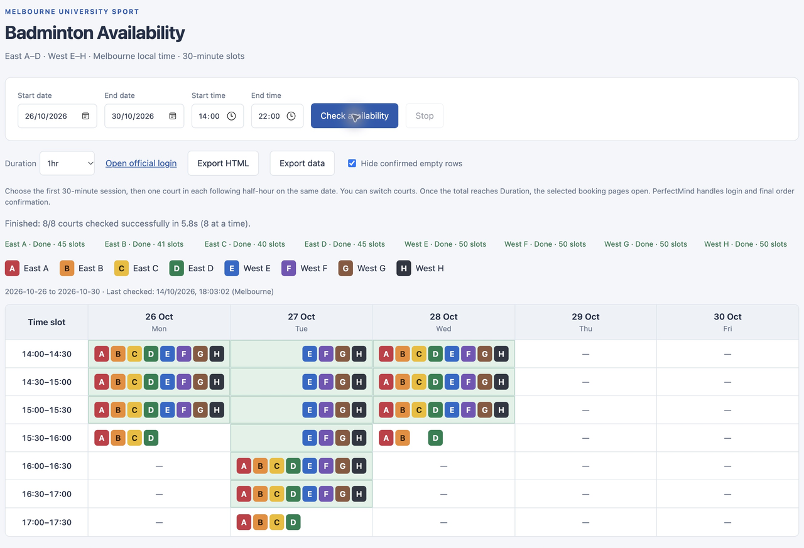

Date/time filters, English interface, court colours and vertical alignment

Choose a date interval and time range; the initial start time is 14:00. Each 30-minute row combines all eight courts. Fixed A–H lanes leave gaps for unavailable courts, keeping the same court vertically aligned. The previous availability query is restored on reopening.

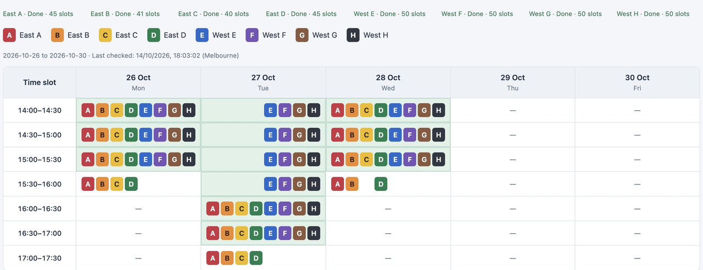

Duration options and whole-cell highlighting

Choose 30min, 1hr, 1hr30min or 2hr; 1hr is the default. Green cells mark start times with an available court in every consecutive half-hour for that duration. The court can change between sessions.

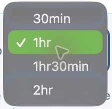

Eight background checks, loading warning, progress, Stop and unknown results

All eight courts are checked concurrently in inactive tabs. The spinner and banner explain that multiple tabs will open. Court progress is reported individually. Stop closes the checking tabs and keeps results already retrieved. A question mark means that a court is still unchecked or failed; it is not treated as confirmed empty availability.

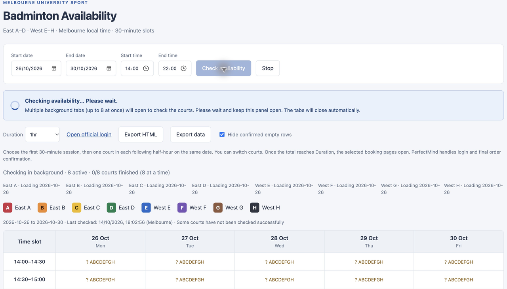

Consecutive sessions across courts, with next-session locking

The first badge selects 30 minutes. It stays highlighted, other sessions turn grey, and only the next consecutive half-hour on the same date remains selectable. This example starts on West E and allows the next session on East A–D.

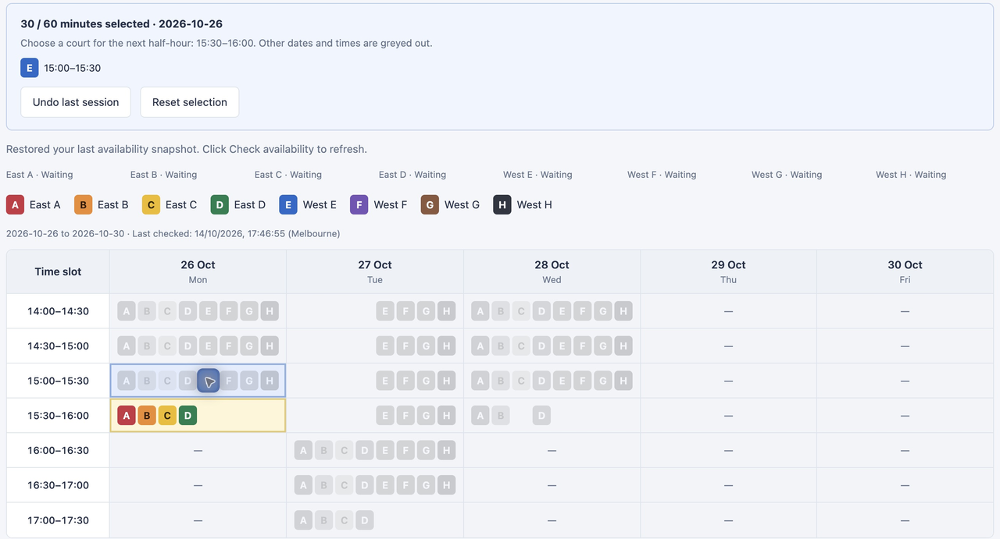

Stable badge position when selection messages appear

The grid stays at the same position on screen when selection feedback or warnings appear. Horizontal scrolling is preserved too. These crops use the same screen rectangle before and after clicking West E at 15:00.

Before selection:

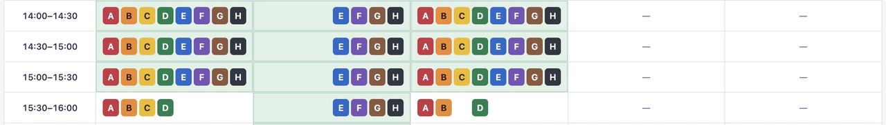

After selection:

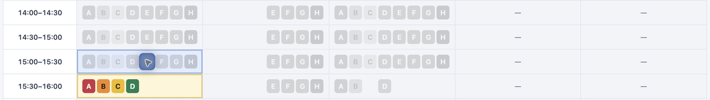

Undo and Reset selection

Undo removes the last selected half-hour; Reset clears the plan. Neither moves the timetable. If rechecking a completed plan fails, Retry opening booking pages is offered so that no order page opens until the entire plan has been verified.

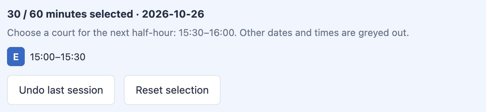

Complete duration, open booking pages and automatic login handling

Once the selected sessions reach Duration, the extension rechecks them and opens the required booking pages. Consecutive sessions on the same court are grouped; a court change creates another page. This 1hr example opens two 30-minute pages. PerfectMind prompts for login when needed, and you complete each order yourself.

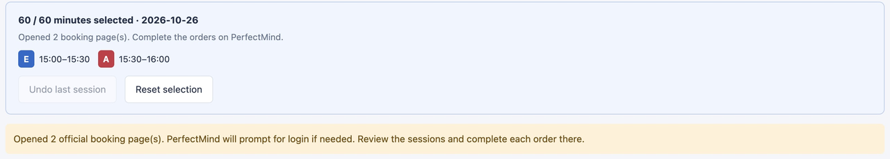

HTML/data exports and hiding confirmed empty rows

Export HTML saves a standalone offline timetable with the current colours, highlights and official timetable links. Export data saves availability and diagnostics as JSON. Hide confirmed empty rows is checked by default; unknown rows stay visible.

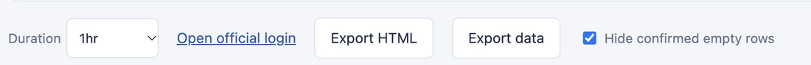

InPrivate availability checking

After allowing the extension in InPrivate, its panel opens in that window. This earlier v1.0.5 capture records all eight courts checked successfully while signed out. Later versions add the selection flow and fixed court lanes shown above.

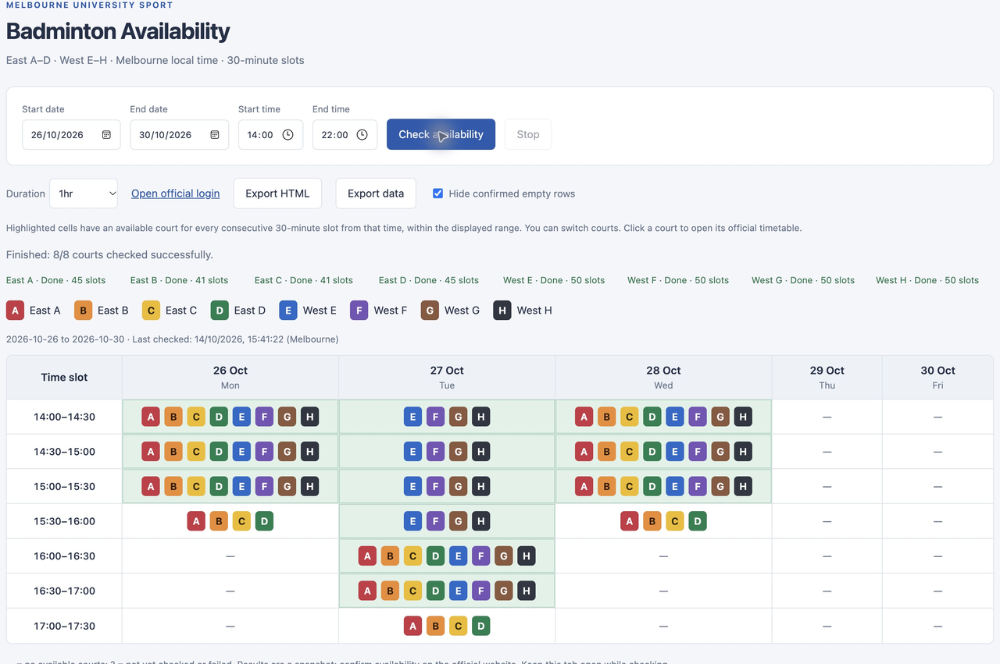

## Install in Edge

1. Open `edge://extensions` in Microsoft Edge.
2. Turn on **Developer mode**.
3. Click **Load Unpacked**.
4. Select the project folder containing `manifest.json`.
5. Click **PerfectMind Badminton Timetable** in the extensions menu. You can pin its icon to the toolbar.

Chrome also works; its management page is `chrome://extensions`.

To update an existing installation, click **Reload** on its extension card, then reopen the panel. If you installed a copied or unzipped folder, replace that folder's files first.

## InPrivate and sign-in

Opening the extension panel does not require a PerfectMind login. Sign in on the official website only if it requires authentication to display availability or make a booking.

To use the extension in Edge InPrivate:

1. Open `edge://extensions` in a regular Edge window.
2. Click **Details** for **PerfectMind Badminton Timetable**.
3. Enable **Allow in InPrivate**.
4. Open an InPrivate window and click the extension icon.

The extension uses split mode and opens its panel in the window where you clicked the icon. Website cookies are separate in InPrivate: a regular-window PerfectMind login does not sign you into InPrivate. Extension-local availability snapshots are shared between regular and InPrivate windows.

## Use

1. Open the panel and choose dates and times. Initially it checks today through six days later, from 14:00 to 22:00. Your previous query is restored if available.
2. Click **Check availability**. All eight courts load in parallel, with no parallel-count setting. A loading banner warns that up to eight background tabs will open and asks you to wait. The official pages load in inactive tabs in the panel's window; each closes automatically when its court finishes.
3. If sign-in is required, click **Open official login**, sign in yourself, and check availability again.
4. You can switch to other tabs and continue browsing while the official pages load in the background. Keep this panel open: closing it does not support continued checking. **Stop** closes the owned loading tabs, stops queued courts and preserves results already retrieved.
5. Choose **30min**, **1hr**, **1hr30min** or **2hr**. Each panel opens with **1hr** selected and **Hide confirmed empty rows** checked.
6. A highlighted cell means that, starting at that time, every consecutive 30-minute slot has at least one confirmed available court for the selected duration. Switching courts is allowed. The period must fit inside the displayed time range.
7. Click the first 30-minute court session. It is highlighted; other dates and times are greyed out. Only courts in the next consecutive half-hour on that date remain selectable. Continue selecting one court per half-hour until the sum reaches **Duration**. A 1hr plan can consist of 30 minutes on one court and 30 minutes on another.
8. Once the required duration is selected, the extension rechecks the entire plan and opens the official booking pages. Adjacent sessions on the same court are combined; different courts and non-adjacent returns to a court get separate pages. If any part is no longer available, no order pages are opened and preparation tabs are closed. Use **Undo last session**, **Reset selection** or **Retry opening booking pages** as appropriate. PerfectMind handles login, attendee selection and final order confirmation. No order is automatically submitted.
9. **Export HTML** saves a standalone file with current highlights, colours and official timetable links. View it offline without the extension; direct booking navigation requires the extension panel. **Export data** saves JSON, including loading diagnostics. Modifier-clicks (such as Cmd/Ctrl-click) also use the ordinary timetable link.

`—` means no available courts were found after a successful check. `?` means a court has not been checked successfully. Unknown or failed results remain visible when empty rows are hidden. Hiding rows does not join separate periods into a continuous period.

Every date column has eight fixed court lanes, A–H. Missing courts leave blank positions so sessions on the same court stay vertically aligned. The timetable keeps its screen position and horizontal scroll when selection feedback, warnings, Undo or Reset change the page above it. Changing Duration clears an unfinished selection. Selection is temporary; exported HTML retains the full availability timetable and official timetable links.

Opening `index.html` directly displays the panel, but checking availability requires opening it from the installed extension.

## Data and maintenance

- Access is limited to `https://unimelb.perfectmind.com/*`, script execution and extension-local storage.
- The extension does not collect passwords or export login cookies. Availability, query dates, status and timestamps are saved locally in your browser.
- The extension's interface, messages, date headings and HTML exports are in English. Native browser date/time controls follow your browser or operating system locale.
- Each query is limited to 42 days. The school's booking window may be shorter.
- Query dates use `Australia/Melbourne`. Pagination follows the actual calendar columns, without assuming seven visible days per page.
- Results are snapshots. Courts load in parallel, with dates within each court checked sequentially. Confirm availability and book on the official website.
- All eight courts load in parallel. Actual speed depends on the website, connection and browser. Completion status includes elapsed time.
- The collector waits for PerfectMind's own availability request, then reads its populated data. It explicitly selects 30 minutes even if PerfectMind retained a longer duration. It does not call the unconfigured Kendo `dataSource.read()`, which would clear the slots. Collector errors are reported rather than treated as empty availability.
- Changes to the official DOM, date format or initialisation may require updating `collector.js`.

## Files

- `manifest.json`: metadata and permissions.
- `background.js`: opens the panel from the extension icon.
- `index.html` and `style.css`: interface and timetable.
- `app.js`: query orchestration, highlighting, links, storage and exports.
- `collector.js`: reads the official calendar.
- `booking.js`: rechecks the selected slot and builds the official booking or login destination. It does not submit a reservation, accept terms or make a payment.

## Versions

- **1.1.1**: anchors the timetable during selection feedback and notices, preserves horizontal scrolling and keyboard focus, and adds an extension-only screenshot guide to the README.

- **1.1.0**: consecutive 30-minute session selection across courts, initial-session highlighting and next-slot locking, undo/reset/retry, revalidation of the full plan before opening order pages, same-court grouping, vertically aligned A–H lanes, retained-duration normalization and clearer collection errors.
- **1.0.8**: always checks all eight courts together, removes the parallel-count control, and lets PerfectMind handle login automatically through its direct booking route.
- **1.0.7**: visible loading spinner and background-tab notice; court clicks open the official booking form using fresh availability and the selected duration, with login return routing when required.
- **1.0.6**: selectable parallel court loading (1/2/4/8), inactive tabs tied to the panel window, failure isolation, serialised snapshot writes, stop cleanup and elapsed time.
- **1.0.5**: split-mode InPrivate support; opens the panel in the window where its icon was clicked.
- **1.0.4**: English interface, metadata, progress and error messages, date headings, HTML exports and documentation.
- **1.0.3**: whole-cell highlighting with court switching; defaults to 1hr and hidden confirmed empty rows.
- **1.0.2**: duration selector and clickable official court links.
- **1.0.1**: fixed empty results caused by clearing the local calendar data source. Verified all eight courts for 19–20 October 2026 in the installed Edge extension.

Installation reference: [Microsoft Edge documentation](https://learn.microsoft.com/en-us/microsoft-edge/extensions/getting-started/extension-sideloading).

## Developer verification

With Node.js installed, run `node tests/parallel.test.cjs`, `node tests/booking.test.cjs`, `node tests/selection.test.cjs`, `node tests/collector.test.cjs` and `node tests/layout.test.cjs`. Checks cover parallel loading, loading-notice cleanup, slot/date locking, duration totals, cross-court plans, adjacent grouping, revalidation failure cleanup, undo/reset, destination validation, duplicate-page prevention, and stable vertical/horizontal positioning during selection, notices and undo/reset.

Live verification in Edge for 26–30 October 2026: all eight courts checked in 5.6 seconds; West E 15:00–15:30 plus East A 15:30–16:00 opened two official 30-minute booking routes, each redirected to PerfectMind login for a signed-out session. No orders were submitted.
